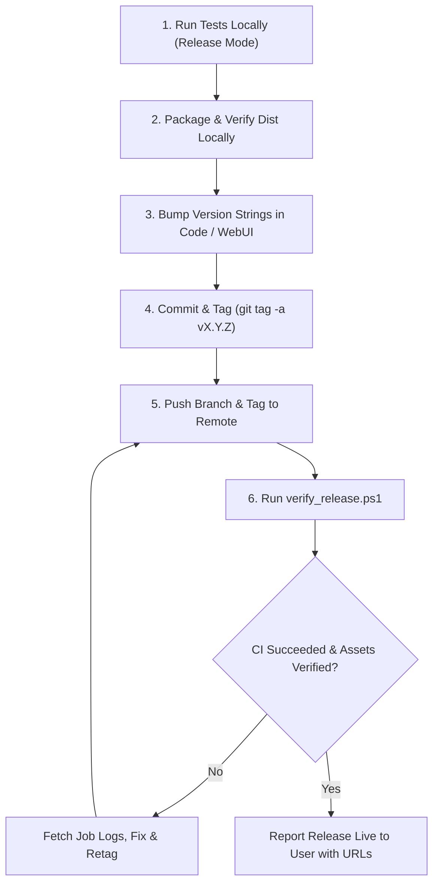

# GitHub Release & Workflow Automation Standard

This skill defines the mandatory protocol for managing GitHub repositories, CI/CD pipelines, automated testing, and software releases across all projects.

---

## 1. Non-Negotiable Core Principles

### Principle 1: Pushing a Tag is NOT a Release
- Running `git push origin <tag>` triggers a background workflow on GitHub Actions. It is **never** proof that a release succeeded.
- **Strict Rule**: Never declare to the user that a release is complete immediately after pushing a git commit or tag. You must actively monitor the GitHub Actions run and verify that the release assets are published.

### Principle 2: Mandatory Workflow Permissions (Option 2)
All repositories using GitHub Actions for releases require:
- **Repository Settings > Actions > General > Workflow permissions**:
  - Select **"Read and write permissions"** (Option 2).
  - Check **"Allow GitHub Actions to create and approve pull requests"**.
- In every release workflow YAML (`.github/workflows/release.yml`), explicitly include:
  ```yaml
  permissions:
    contents: write
  ```

### Principle 3: Environment-Agnostic, CI-Safe Testing
- **Never hardcode developer local paths** (`C:\Users\...`, `C:\Projects\...`) in tests or build scripts.
- CI runners (`windows-latest`, `ubuntu-latest`) run in isolated environments without developer-specific directories.
- Any test that audits or reads local assets must guard file system checks with:
  ```csharp
  if (!Directory.Exists(localDir))
  {
      _output?.WriteLine($"[SKIPPED] Local directory not present on CI runner: {localDir}");
      return;
  }
  ```
- Always execute tests locally in **Release** configuration prior to pushing tags.

---

## 2. Release Execution Protocol

When releasing a new version (`vX.Y.Z`):



### Step-by-Step Procedure

1. **Pre-Flight Validation**:
   - Run the local test suite:
     ```powershell
     dotnet test -c Release
     ```
   - Ensure 0 test failures.

2. **Version Bump**:
   - Update project file versions (`<Version>`, `<AssemblyVersion>`, `<FileVersion>`).
   - Update UI cache-busting strings (e.g., `<script src="app.js?v=X.Y.Z">`).
   - Update release notes generator scripts if applicable.

3. **Local Dist Build**:
   - Produce standalone executables and zip archives locally into `dist/`.
   - Ensure `.gitignore` ignores `publish_output/`, `release_assets/`, and temporary build outputs.

4. **Commit & Tag**:
   ```powershell
   git add -A
   git commit -m "chore: bump version to X.Y.Z"
   git tag -a vX.Y.Z -m "Release vX.Y.Z"
   ```

5. **Push to Remote**:
   ```powershell
   git push origin main
   git push origin vX.Y.Z
   ```

6. **Automated Verification (Mandatory)**:
   - Run the automated verification script:
     ```powershell
     powershell -ExecutionPolicy Bypass -File ".agents/skills/github-release-management/scripts/verify_release.ps1" -Tag "vX.Y.Z"
     ```
   - Wait until `status == "completed"` and `conclusion == "success"`.
   - Query `api.github.com/repos/<owner>/<repo>/releases` and confirm:
     - `draft == false`
     - Asset count matches expected output (e.g. `.exe`, `.zip`, scripts).
     - Each asset has `size > 0`.

7. **Final User Notification**:
   - Provide direct clickable links to the GitHub Release page and individual asset download links.
